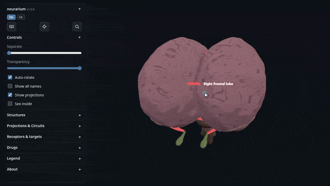

<p align="center">
  
</p>

# neurarium

*Lire ceci en [anglais / in English](README.md).*

> [!NOTE]
> Cette page a été **traduite automatiquement** : le ton peut sonner un peu faux, mais
> l'idée reste la même. Le document de référence, relu et vérifié, est le
> [README en anglais](README.md).

neurarium est ma modeste tentative d'**encyclopédie du cerveau en 3D** où chaque fait
est étayé par une source fiable (un manuel médical de référence, une base de données
pharmacologique en ligne, un article de recherche), réorganisée en un cerveau 3D
intuitif que l'on peut faire pivoter, éclater, fouiller et explorer au clic.

Le savoir sur le cerveau est d'ordinaire éparpillé entre atlas, schémas de voies,
tableaux de récepteurs et monographies de médicaments. neurarium le pose sur un seul
modèle 3D pour que les *relations* (quelle région projette où, quel récepteur siège
dans quelle structure, ce qu'un médicament fait et à quoi) sautent aux yeux au lieu
d'être reconstruites de tête. Comme le jeu de données est assemblé par machine, chaque
fait porte une pastille colorée indiquant à quel point il est sourcé, pour que l'on
sache toujours quelle confiance lui accorder.

En ligne sur **[neurarium.olicorne.org](https://neurarium.olicorne.org)**.

[](https://neurarium.olicorne.org)

> [!IMPORTANT]
> <!-- SOURCED_HEADLINE:START --><b>97% of the 10213 knowledge nodes are sourced or verified</b><!-- SOURCED_HEADLINE:END -->
> dans le jeu de données livré, et chaque fait dans l'application porte une note de
> provenance que l'on peut inspecter (voir [Comment fonctionne le sourçage ?](#how-does-the-sourcing-work)).

> [!WARNING]
> **Travail en cours : il contient très probablement des erreurs.** L'anatomie
> (régions, formes, projections, descriptions) n'est pas encore relue ni sourcée et
> peut contenir des hallucinations du modèle ; les données sur les médicaments sont
> extraites automatiquement (les médicaments psychiatriques du *Prescriber's Guide* de
> Stahl, les autres substances des affinités PDSP Ki mesurées) et ne sont pas relues non
> plus. neurarium est un outil précoce pour explorer, apprendre ou trouver des sources, **pas**
> une référence clinique de premier plan : ne vous y fiez pas, et ne pariez jamais les
> soins d'un patient uniquement dessus.

> [!TIP]
> **Utilisable par les IA :** collez une fois [`neurarium.olicorne.org/llms.txt`](https://neurarium.olicorne.org/llms.txt) dans Claude, ChatGPT, Le Chat, Gemini ou un autre assistant et demandez-lui de retenir le site : il pourra ensuite chercher et vérifier les faits de neurarium avec leurs citations sources (voir [Puis-je interroger un assistant IA à son sujet ?](#can-i-ask-an-ai-assistant-about-it)).

## FAQ

- [Quelles informations trouve-t-on à l'intérieur ?](#what-kind-of-information-is-inside)
- [Qui a fait neurarium ?](#who-made-neurarium)
- [Pourquoi l'avoir fait ?](#why-did-you-make-it)
- [Est-ce gratuit ?](#is-it-free)
- [Comment le lancer moi-même ?](#how-do-i-run-it-myself)
- [Comment fonctionne le sourçage ?](#how-does-the-sourcing-work)
- [Quelles sont les sources ?](#what-are-the-sources)
- [Comment réutiliser les données ?](#how-can-i-reuse-the-data)
- [Puis-je interroger un assistant IA à son sujet ?](#can-i-ask-an-ai-assistant-about-it)
- [Quelle est la licence, et pourquoi ?](#whats-the-license-and-why)
- [Qu'y a-t-il sur la feuille de route ?](#whats-on-the-roadmap)
- [Avec quoi est-ce construit ?](#what-is-it-built-with)
- [Comment donner un retour ou me contacter ?](#how-do-i-give-feedback-or-get-in-touch)

<a name="what-kind-of-information-is-inside"></a>
<details>
<summary><strong>Quelles informations trouve-t-on à l'intérieur ?</strong></summary>

Quatre couches de données sur un seul modèle, toutes cliquables :

| Couche | Ce que vous voyez | Ce que vous pouvez en faire |
| --- | --- | --- |
| **Anatomie** | Les lobes corticaux, les ganglions de la base, le diencéphale, le système limbique et le tronc cérébral comme un seul maillage 3D procédural | Faire pivoter, éclater via un curseur pour révéler les noyaux profonds, passer en transparence, ôter la face avant, ou isoler une structure |
| **Câblage** | Les projections neuronales sous forme de flèches orientées, colorées par type (excitateur, dopaminergique, ...) ou par signe excitateur/inhibiteur | Cliquer une voie pour son trajet, son transmetteur et ses sources ; jouer un **circuit fonctionnel** nommé sous forme d'impulsion qui se propage |
| **Récepteurs & cibles** | Les récepteurs ainsi que d'autres cibles moléculaires (transporteurs, enzymes, canaux ioniques) | En focaliser un : le cerveau s'assombrit sur les structures qui l'expriment (parsemées de points lumineux), à côté de sa classe, son signe et de chaque médicament qui agit dessus |
| **Médicaments** | Des médicaments psychiatriques (tirés du *Prescriber's Guide* de Stahl) aux côtés de substances récréatives et autres substances psychoactives (LSD, MDMA, kétamine, cocaïne, nicotine, ...), et ouvert à d'autres : un médicament n'est qu'une ligne de liaisons sourcées, donc toute substance dont les affinités sont publiées peut être ajoutée | En focaliser un : des points colorés par effet (renforce / bloque / module) s'animent sur les régions qu'il touche, des billes circulent le long des systèmes de transmetteurs par lesquels il agit, et le panneau montre sa structure, sa classe, ses liaisons et la source de chacune |
| **Tout** | Une seule barre de recherche ; état entièrement adressable par URL | Chercher régions, voies, récepteurs et médicaments à la fois ; pivoter d'un médicament vers sa classe ou d'une cible vers chaque médicament qui l'atteint ; partager n'importe quelle vue par lien profond |

Sous le capot, c'est un **graphe de nœuds**. Un *nœud* est toute donnée sourçable : une
région du cerveau, une projection entre deux régions, un circuit fonctionnel, un
récepteur, l'expression d'un récepteur dans une région donnée, un médicament, une seule
liaison médicament-cible. Les nœuds sont reliés entre eux, donc un panneau de détail est
une vue d'**un nœud plus chaque nœud qui lui est lié**, et l'on explore de proche en
proche à partir de ce que l'on a cliqué.

</details>

<a name="who-made-neurarium"></a>
<details>
<summary><strong>Qui a fait neurarium ?</strong></summary>

Initialement construit en moins d'une semaine par
[Olivier Cornelis](https://olicorne.org/), développeur français et interne en
psychiatrie, avec l'aide de [Claude Code](https://claude.com/claude-code).

</details>

<a name="why-did-you-make-it"></a>
<details>
<summary><strong>Pourquoi l'avoir fait ?</strong></summary>

Cela a commencé comme une démo de quelques jours pendant mon internat de médecine, et le
projet n'a cessé d'absorber de nouveaux types de données plus facilement que prévu. La
frustration récurrente auquel il répond : les faits nécessaires pour raisonner sur le
cerveau sont vrais mais *éparpillés*, ses régions dans un atlas, son câblage dans un
autre, ses récepteurs dans un tableau, ses médicaments dans des monographies, si bien
que l'on dépense son énergie à reconstruire les liens au lieu de s'en servir. Les poser
sur une seule carte, chacun avec une note de source visible, fait de ces liens ce que
l'on regarde.

Convaincu de l'utilité de réorganiser l'information sous forme de données structurées, je
crois que ce genre de visualiseur interactif et gradué par source pourrait servir
au-delà de la psychopharmacologie, et je construirais volontiers des animations
similaires pour **d'autres sujets médicaux**. Si vous pensez qu'une carte de ce type
aiderait votre enseignement ou votre recherche, [prenez contact](https://olicorne.org/en/contact).

</details>

<a name="is-it-free"></a>
<details>
<summary><strong>Est-ce gratuit ?</strong></summary>

Oui. C'est gratuit à l'usage sur [neurarium.olicorne.org](https://neurarium.olicorne.org),
libre et open source (voir [la licence](#whats-the-license-and-why)), et les données
sous-jacentes sont libres de réutilisation (voir [Comment réutiliser les données ?](#how-can-i-reuse-the-data)).
Pas de compte, pas de pistage au-delà de simples compteurs d'usage anonymes, pas de
péage.

</details>

<a name="how-do-i-run-it-myself"></a>
<details>
<summary><strong>Comment le lancer moi-même ?</strong></summary>

La page charge ses données avec `fetch()`, elle doit donc être servie en HTTP (pas
ouverte depuis le disque). Le site servi est `public/`. Depuis la racine du dépôt :

```sh
python tools/serve.py            # sert public/ avec le cache désactivé
# ou : cd public && python -m http.server 8000
```

Puis ouvrez <http://localhost:8000/>.

Pour le déploiement, il existe un conteneur [Caddy](https://caddyserver.com/) durci sous
`docker/` ; le flux de données complet et le graphe des modules sont dans
[`ARCHITECTURE.md`](docs/ARCHITECTURE.md).

</details>

<a name="how-does-the-sourcing-work"></a>
<details>
<summary><strong>Comment fonctionne le sourçage ?</strong></summary>

Comme le jeu de données est vaste et assemblé par machine, la question honnête pour tout
nœud est *comment le sait-on ?* Chaque source affichée dans un panneau y répond en ligne
par une **pastille de provenance** colorée. L'objectif est que **chaque nœud porte une
source**, et la pastille rend les lacunes visibles. Du plus faible au plus fort :

- **orange `NOSOURCE` :** pas encore de source ni de référence pour ce nœud.
- **gris `?` (LLM seul) :** produit par un modèle de mémoire, non vérifié ; peut être une hallucination.
- **jaune `~` (sourcé) :** issu du document cité, mais le nœud lui-même n'a pas été vérifié par citation.
- **vert `✓` (vérifié) :** un modèle a extrait une citation, sa présence dans la source citée a été confirmée *programmatiquement*, et un second modèle a convenu qu'elle étaye le nœud. Note la plus élevée disponible, et toujours pilotée par un modèle.

La note fait partie des données, relevée à mesure que chaque nœud est vérifié, si bien
que la couverture ci-dessous est un décompte réel :

<!-- SOURCING_STATS:START (generated by tools/update_readme_stats.py; do not edit by hand) -->

**97% of the 10213 knowledge nodes in the dataset are sourced or verified.** A node is any sourceable datum (a region, a pathway, a receptor, a drug binding, ...). This is a programmatic count (`tools/update_readme_stats.py`, from the emitted data), not hand-typed:

```
Drug metabolising enzymes                        ██████████████████████████  100%    573/573
Receptor & target gene variants                  ██████████████████████████  100%    546/546
Wikipedia reference links                        ██████████████████████████  100%    445/445
Drug holders                                     ██████████████████████████  100%    305/305
Drug lipophilicity (XLogP3)                      ██████████████████████████  100%    286/286
Drug polar surface area                          ██████████████████████████  100%    286/286
Drug pre-prescription workup (BETA)              ██████████████████████████  100%    246/246
Drug blood-brain barrier label                   ██████████████████████████  100%    239/239
Drug first approval                              ██████████████████████████  100%    229/229
Drug formulations (release type)                 ██████████████████████████  100%    193/193
Receptor clinical effects (beta)                 ██████████████████████████  100%    178/178
Drug time-to-peak (Tmax)                         ██████████████████████████  100%    170/170
Drug metabolite bindings                         ██████████████████████████  100%    151/151
Drug therapeutic reference ranges                ██████████████████████████  100%    136/136
Drug laboratory alert levels                     ██████████████████████████  100%    130/130
Drug nomenclature (NbN)                          ██████████████████████████  100%    116/116
Drug originator                                  ██████████████████████████  100%    113/113
Clearance-speed prescribing guidance             ██████████████████████████  100%    104/104
Drug originator country                          ██████████████████████████  100%      81/81
Drug active metabolites                          ██████████████████████████  100%      71/71
Receptor release modulation (beta)               ██████████████████████████  100%      64/64
Brain-region anatomy                             ██████████████████████████  100%      57/57
Receptor system/family                           ██████████████████████████  100%      56/56
Receptor mechanism class                         ██████████████████████████  100%      56/56
Receptor relative amount per region              ██████████████████████████  100%      36/36
Drug market withdrawals                          ██████████████████████████  100%      28/28
Target classifications                           ██████████████████████████  100%      25/25
Metabolite-forming enzymes                       ██████████████████████████  100%      23/23
Target relative amount per region                ██████████████████████████  100%      21/21
Receptor availability across age and sex (beta)  ██████████████████████████  100%      21/21
Projection groups                                ██████████████████████████  100%      12/12
Drug prodrug flags                               ██████████████████████████  100%      11/11
Functional circuits                              ██████████████████████████  100%        6/6
Enzyme population variability                    ██████████████████████████  100%        5/5
Panel annotations                                ██████████████████████████  100%        4/4
Target tone polarity                             ██████████████████████████  100%        2/2
Drug salt / combination constituents             ██████████████████████████  100%        1/1
Drug brand names                                 ██████████████████████████  100%    575/577
Neuron pathways                                  ██████████████████████████   99%    115/116
Drug target bindings                             ██████████████████████████   99%  1953/1971
Drug half-life (T½)                              ██████████████████████████   98%    270/275
Drug class                                       █████████████████████████░   98%    295/301
Receptor expression regions                      ████████████████████████░░   94%    360/383
Drug metabolism strength tier                    ████████████████████████░░   93%    138/148
Receptor sign (excit./inhib.)                    ████████████████████████░░   91%      51/56
Target expression regions                        ███████████████████████░░░   89%    115/129
Drug binding directions                          ███████████████████████░░░   88%  1294/1466
Pathway transmitter                              ██████████████████████░░░░   84%     98/116
Pathway sign (excit./inhib.)                     █████████████████████░░░░░   79%      30/38
Receptor pre/postsynaptic site                   ████████████████████░░░░░░   75%      42/56
```

Separately, **measured binding affinity (PDSP Ki) covers 85% of the 1952 drug bindings**; 88 of 275 drugs carry no Ki on any binding (sourced by book quote only, or not yet sourced). A Ki is a measured value, not a grade: this tracks where one was never looked up, complementing the sourcing figure above.

Of those, **439 carry an `uncertain` badge**: the quote is confirmed present in the source, but the sentence states something broader than the claim (a rule that never names the drug, a sweep that never names the region), so pinning it to that node is an inference. The badge's tooltip lists the reasons to doubt it, each with its own source.

Besides those, **667 claims are `unknown` (∅)**: every source the dataset requires for that kind of claim was searched on a recorded date and none states it. That is a finding about the literature, not a gap, so they are left out of the % above; the search is redone within 12 months.

<!-- SOURCING_STATS:END -->

Les liaisons de médicaments sont en tête parce qu'elles passent la porte complète de
vérification par citation ; l'anatomie, les voies et les régions d'expression sont le
front actuel. La même légende et la même barre de couverture figurent dans le panneau À
propos de l'application.

</details>

<a name="what-are-the-sources"></a>
<details>
<summary><strong>Quelles sont les sources ?</strong></summary>

<!-- SOURCES_TABLE:START (generated by tools/update_readme_stats.py; do not edit by hand) -->

Every `~` and `✓` grade is checked against one of the sources below. Each is a standard, widely cited reference in its field, not a casual web page:

| Source | Field | Grades here |
| --- | --- | --- |
| [Prescriber's Guide: Stahl's Essential Psychopharmacology, 8th ed.](https://doi.org/10.1017/9781009464772) | Clinical psychopharmacology | Drug bindings, nomenclature, class |
| [Kandel, Principles of Neural Science, 6th ed.](https://search.worldcat.org/search?q=bn:9781259642234) | Neuroscience (standard textbook) | Neuron pathways, region anatomy |
| [Stahl's Essential Psychopharmacology: Neuroscientific Basis, 5th ed.](https://doi.org/10.1017/9781108975292) | Psychopharmacology (mechanisms) | Receptor & target mechanism |
| [Carlat Medication Fact Book for Psychiatric Practice, 7th ed.](https://search.worldcat.org/search?q=bn:9798987335482) | Clinical psychopharmacology | Drug bindings (cross-check) |
| [Nieuwenhuys, Voogd & van Huijzen, The Human Central Nervous System, 4th ed.](https://doi.org/10.1007/978-3-540-34686-9) | Neuroanatomy (CNS atlas) | Region anatomy, connectivity |
| [IUPHAR/BPS Guide to Pharmacology (GtoPdb), tissue distribution](https://www.guidetopharmacology.org/) | Molecular pharmacology (IUPHAR/BPS database) | Receptor & target expression regions |
| [PDSP Ki Database (NIMH PDSP)](https://pdspdb.unc.edu/databases/kidb.php) | Receptor binding pharmacology | Drug binding affinities (Ki) |
| [Allen Human Brain Atlas, microarray (Hawrylycz et al. 2012)](https://human.brain-map.org/) | Brain transcriptome atlas (microarray) | Receptor & target expression regions |
| [Wikipedia (English), drug article (pharmacology sections)](https://en.wikipedia.org/) | Encyclopedia (pharmacodynamics tables) | Drug binding affinities (Ki) |
| [Wikipedia (French), drug article (commercial names)](https://fr.wikipedia.org/) | Encyclopedia (French, article prose) | Drug brand names (European / French) |
| [IUPHAR/BPS Guide to Pharmacology (GtoPdb), ligand interactions](https://www.guidetopharmacology.org/) | Molecular pharmacology (IUPHAR/BPS database) | Drug binding affinities (Ki) and direction |
| [IUPHAR/BPS Guide to Pharmacology (GtoPdb), target classification](https://www.guidetopharmacology.org/) | Molecular pharmacology (IUPHAR/BPS database) | Receptor & target mechanism class, receptor sign |
| [IUPHAR/BPS Guide to Pharmacology (GtoPdb), target function](https://www.guidetopharmacology.org/) | Molecular pharmacology (IUPHAR/BPS database) | Receptor & target physiological effects |
| [PharmFreq, metabolizer status by population](https://pharmfreq.com) | Pharmacogenomic allele frequencies | Enzyme clearance speed by population |
| [DailyMed (U.S. NLM), prescribing label, clinical pharmacology](https://dailymed.nlm.nih.gov/) | US prescribing labels (NLM SPL archive) | Drug time-to-peak (Tmax) |
| [Base de données publique des médicaments (ANSM), RCP](https://base-donnees-publique.medicaments.gouv.fr/) | French public drug database (ANSM RCPs) | Drug Tmax, half-life, French brands |
| [Base de données publique des médicaments (ANSM) or EMA EPAR, RCP sections 4.2-4.4](https://base-donnees-publique.medicaments.gouv.fr/) | French drug database (BDPM) or EMA EPAR, RCP sections 4.2-4.4 | Drug pre-prescription workup (tests before and during treatment) |
| [CPIC, clinical pharmacogenetics dosing guideline](https://cpicpgx.org/) | Pharmacogenomic prescribing guidelines | What a clearance speed implies for a drug |
| [Europe PMC, journal article](https://europepmc.org/) | Primary literature (Europe PMC abstracts) | Claims only a study measures (e.g. brain half-life) |
| [Drugs@FDA (U.S. FDA), approved application history](https://www.accessdata.fda.gov/scripts/cder/daf/) | US regulator register (Drugs@FDA) | First US approval, where no other source dates one |
| [ClinPGx (PharmGKB), clinical annotation](https://www.clinpgx.org/) | Pharmacogenomic annotations (ClinPGx) | Receptor & target gene variant associations |
| [PubChem (NCBI), computed compound properties](https://pubchem.ncbi.nlm.nih.gov/) | Chemistry database (PubChem computed properties) | Drug lipophilicity (XLogP3), polar surface area |
| [B3DB, blood-brain barrier permeability database](https://github.com/theochem/B3DB) | Blood-brain barrier database (B3DB) | Drug brain entry (BBB+ / BBB-, logBB) |
| [AGNP Consensus Guidelines for TDM in Neuropsychopharmacology, 2026](https://doi.org/10.1055/a-2860-7861) | Consensus guideline (AGNP TDM, 2026) | Therapeutic range, alert level, CYP substrate cross-check |

Some sources ask that any reuse of their data cite them:

- Harding SD, Armstrong JF, Faccenda E, Southan C, Alexander SPH, Davenport AP, Spedding M, Davies JA. The IUPHAR/BPS Guide to PHARMACOLOGY in 2026. Nucleic Acids Res. 2026;54(D1):D1446-D1456. doi:10.1093/nar/gkaf1067. PMID 41160876.
- Alexander SPH, Davenport AP, Kelly E, et al. The Concise Guide to PHARMACOLOGY 2025/26: G protein-coupled receptors. Br J Pharmacol. 2025;182:S24-S151 (and the matching 2025/26 chapter for each other target family).
- IUPHAR/BPS Guide to PHARMACOLOGY content licensed under CC BY-SA 4.0 (database ODbL).

<!-- SOURCES_TABLE:END -->

**Wikipédia** est en dehors du tableau ci-dessus. Les descriptions de médicaments et de
structures ainsi que les images de molécules sont récupérées en direct depuis l'article
Wikipédia courant à l'exécution (sous
[CC BY-SA](https://creativecommons.org/licenses/by-sa/4.0/)), de sorte que le jeu de
données ne livre aucune prose sous droit d'auteur. Une récupération en direct est une
lecture programmatique verbatim qui ne peut pas diverger de la source, donc dans
l'application celles-ci portent une pastille verte `✓` ; elles sont comptées comme des
liens de référence (la ligne « Wikipedia reference links » de la couverture ci-dessus),
tenues à part du total des nœuds de connaissance.

Les références de livres sont sous droit d'auteur, donc seul l'outillage qui les utilise
est versionné, pas le texte. Quiconque possède un exemplaire peut reproduire
l'extraction et confirmer chaque citation gradée `✓` : déposez le PDF de Stahl dans
`data_sources/books/stahl/` et trois scripts versionnés reconstruisent exactement ce que
la porte de vérification contrôle :

```sh
uv run tools/fetch/pdf_to_pages.py    # le PDF -> un fichier Markdown par page
uv run tools/fetch/build_index.py     # l'index des pages par médicament
python tools/check_data.py            # revérifie que chaque citation est sur la page citée
```

</details>

<a name="how-can-i-reuse-the-data"></a>
<details>
<summary><strong>Comment réutiliser les données ?</strong></summary>

L'anatomie est une simple **donnée structurée**, tenue délibérément à l'écart du rendu.
Sous `public/data/`, elle est répartie par type de nœud (un objet JSON par ligne) à côté
d'un `meta.json` auto-descriptif (cartes de couleurs et de légende, plus le décompte de
sourçage) et d'un fichier de géométrie par forme. Elle est générée depuis une source de
vérité unique (`tools/generate_data.py`, avec la liste des médicaments dans
`tools/data/drugs_data.jsonl`), si bien que le JSONL/JSON brut est facile à consommer
depuis un autre moteur.

| Fichier | Ce qu'il contient |
| --- | --- |
| [`structures.jsonl`](public/data/structures.jsonl) | Régions du cerveau (position, groupe, réf. de géométrie, sources) |
| [`projections.jsonl`](public/data/projections.jsonl) | Voies neuronales (de -> vers, transmetteur, signe, sources) |
| [`circuits.jsonl`](public/data/circuits.jsonl) | Circuits fonctionnels nommés |
| [`projection_groups.jsonl`](public/data/projection_groups.jsonl) | Groupes de voies par transmetteur / par effet |
| [`receptors.jsonl`](public/data/receptors.jsonl) | Récepteurs : classification + régions d'expression, chacune gradée |
| [`drugs.jsonl`](public/data/drugs.jsonl) | Médicaments : liaisons (cible, action, Ki), classe, nomenclature |

Chaque ligne de chaque fichier porte sa propre note de provenance et sa source, si bien
que le graphe reste auto-descriptif. Pour savoir comment étendre le jeu de données, la
référence par outil et le contrat de champs des données émises, voir
[`tools/README.md`](tools/README.md). Les données sont sous la même
[licence](#whats-the-license-and-why) que le code.

</details>

<a name="can-i-ask-an-ai-assistant-about-it"></a>
<details>
<summary><strong>Puis-je interroger un assistant IA à son sujet ?</strong></summary>

Oui, neurarium est utilisable par les IA. Collez une fois ce lien dans Claude, ChatGPT, Le Chat de Mistral, Gemini ou tout assistant capable de lire des pages web, et demandez-lui de retenir le site :

```
https://neurarium.olicorne.org/llms.txt
```

Cette page indique à l'assistant où se trouve l'ensemble des données et comment les lire, y compris une version texte de chaque panneau sur [`/api/`](https://neurarium.olicorne.org/api/) (une page par médicament, récepteur, région et voie). Vous pouvez ensuite lui demander par exemple « d'après neurarium, sur quoi se lie l'aripiprazole, et à quel point chaque liaison est-elle sourcée ? » : il peut citer la phrase source exacte et le niveau de preuve derrière chaque réponse au lieu de répondre de mémoire. Qu'il garde le lien d'une conversation à l'autre dépend de la fonction mémoire de l'assistant ; s'il l'oublie, recollez le lien.

L'assistant ne lit que ce qu'affirme neurarium : l'avertissement « travail en cours » ci-dessus s'applique toujours. La version texte contient aussi un peu moins que la vue 3D : les sections que celle-ci calcule dans votre navigateur à partir des faits stockés (effets prédits d'un médicament et modulation présynaptique, sa neurotransmission nette estimée, ses interactions pharmacocinétiques, la simulation) n'existent que dans la version 3D.

**Pourquoi pas de serveur MCP ?** Le [Model Context Protocol](https://fr.wikipedia.org/wiki/Model_Context_Protocol) est l'autre façon courante de brancher un site sur un assistant IA, mais il demande un programme serveur à côté du site, un connecteur que chaque utilisateur doit ajouter à la main, et un entretien continu au fil des évolutions du protocole. J'ai choisi de m'en passer : neurarium suit plutôt la convention [`/llms.txt`](https://llmstxt.org), de simples fichiers que tout assistant capable de lire une page web peut utiliser sans rien installer, et qui ne coûtent rien de plus au serveur.

</details>

<a name="whats-the-license-and-why"></a>
<details>
<summary><strong>Quelle est la licence, et pourquoi ?</strong></summary>

[Licence publique générale GNU Affero v3.0 (AGPL-3.0)](LICENSE).

J'ai choisi une licence copyleft forte à dessein : chacun est libre d'utiliser,
d'étudier, de modifier et de bâtir sur neurarium, mais toute réutilisation ou tout
hébergement de celui-ci (y compris une version modifiée exploitée comme site web) doit
garder son code ouvert sous les mêmes termes. L'objectif est de garder le travail et ses
données librement disponibles et d'empêcher qu'ils soient enfermés dans un fork
propriétaire.
Les descriptions de médicaments et les images de structures moléculaires proviennent de
Wikipédia, utilisées sous [CC BY-SA](https://creativecommons.org/licenses/by-sa/4.0/).

</details>

<a name="whats-on-the-roadmap"></a>
<details>
<summary><strong>Qu'y a-t-il sur la feuille de route ?</strong></summary>

Un échantillon des directions envisagées, aucune fixée dans l'ordre : **plus
d'animation** de l'activité et du flux de signal à travers le cerveau ; **plus de
substances** avec leurs noms commerciaux ; les **pathologies** cartographiées sur les
régions, les circuits et les systèmes de transmetteurs ; une **pharmacologie plus
poussée** (interactions enzymatiques CYP, effets récepteurs de second ordre) ; des
**vérifications de cohérence** qui signalent les données qui se contredisent ; et **vers
un sourçage complet**, en relevant la note de chaque nœud du gris vers le vert à mesure
qu'il est vérifié.

</details>

<a name="what-is-it-built-with"></a>
<details>
<summary><strong>Avec quoi est-ce construit ?</strong></summary>

Délibérément léger, avec une faible surface d'attaque et aucune étape de build :

- **Frontend :** des modules ES natifs + [three.js](https://threejs.org/) chargés via une
  import map et embarqués sous `public/vendor/three`, de sorte que la page n'exécute
  aucun script tiers à l'exécution et fonctionne hors ligne. Pas de framework, de
  bundler ni de `node_modules`.
- **Données :** `tools/generate_data.py` (bibliothèque standard Python seulement) émet
  l'anatomie sous `public/data/` (`meta.json` + `*.jsonl` + `shapes/*.json`), récupérée à
  l'exécution.
- **Service :** un conteneur [Caddy](https://caddyserver.com/) durci (non-root, système
  de fichiers en lecture seule, capacités retirées, limites de ressources,
  Content-Security-Policy stricte) derrière un reverse proxy qui termine le TLS.
- **Débogage :** une console à l'écran [eruda](https://github.com/liriliri/eruda),
  chargée seulement en dev ou avec `?debug` afin de ne jamais être livrée aux visiteurs
  ordinaires.

Pour la carte fichier par fichier du visualiseur et les règles non évidentes, voir
[`CLAUDE.md`](CLAUDE.md).

</details>

<a name="how-do-i-give-feedback-or-get-in-touch"></a>
<details>
<summary><strong>Comment donner un retour ou me contacter ?</strong></summary>

Vous avez trouvé un bug, une **inexactitude** anatomique ou pharmacologique, ou vous avez
une **demande de fonctionnalité** ? Merci d'**ouvrir une issue** sur ce dépôt. Les
corrections aux données de régions, de projections, de récepteurs et de médicaments sont
particulièrement bienvenues, tout comme les **idées de ce qui a sa place sur une carte de
ce type**.

Pour toute autre chose, ou pour parler d'un visualiseur similaire sur un autre sujet
médical, vous pouvez me joindre sur [mon site](https://olicorne.org/en/contact).

</details>
