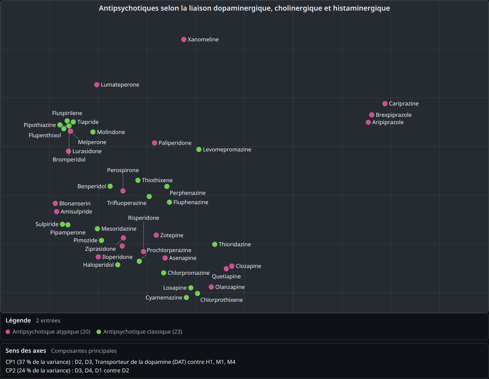
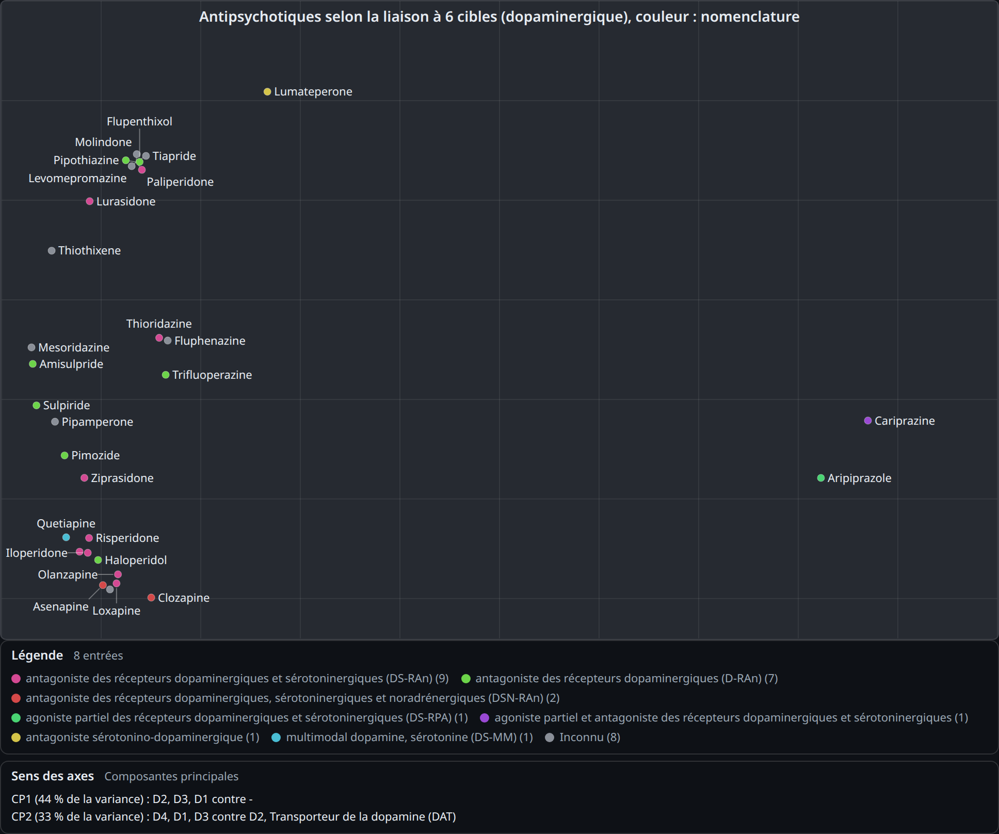
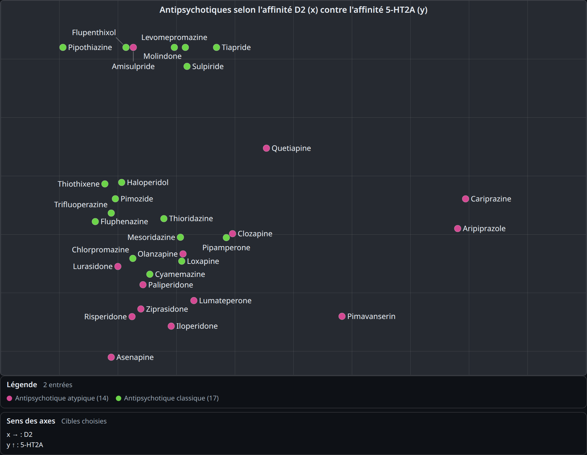
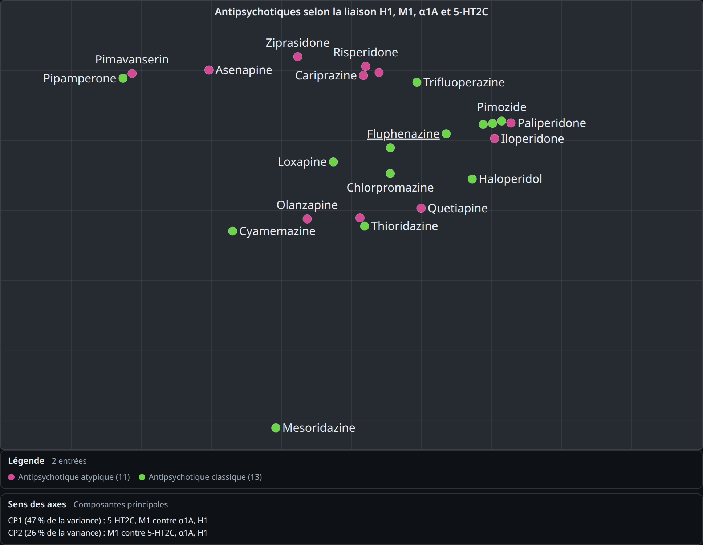
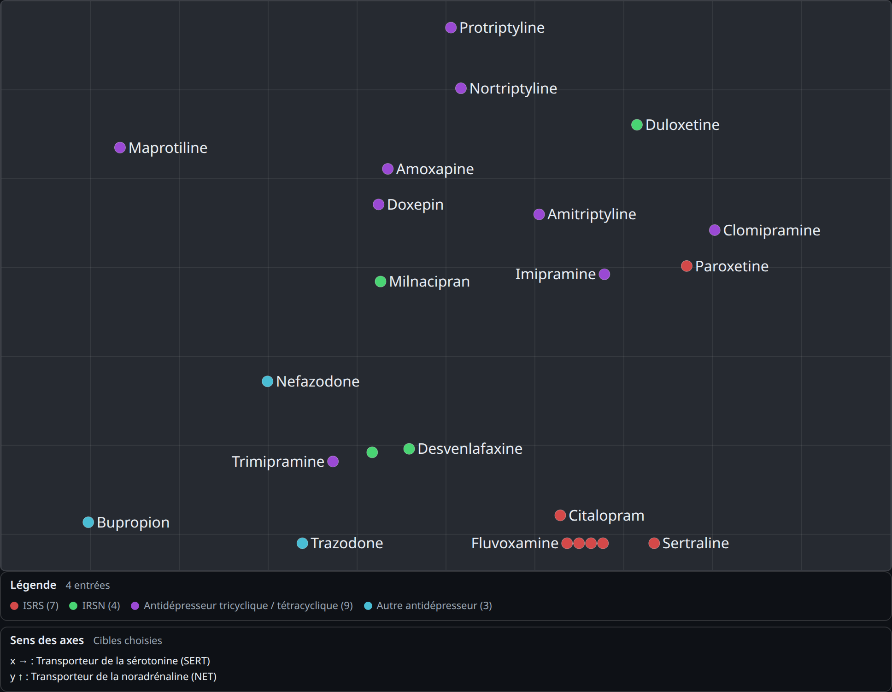
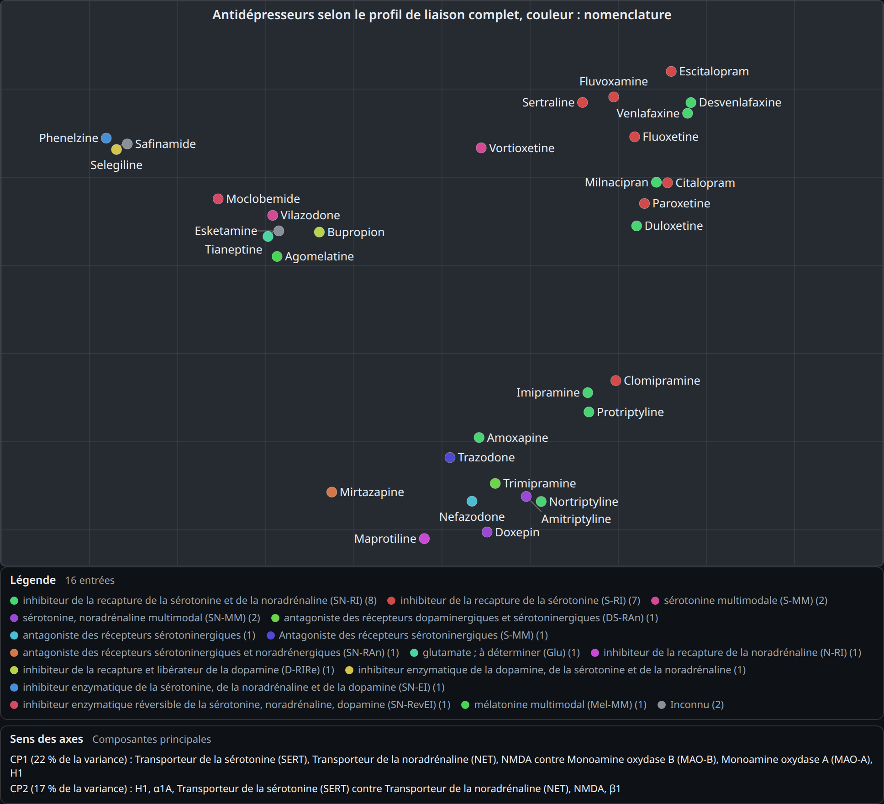
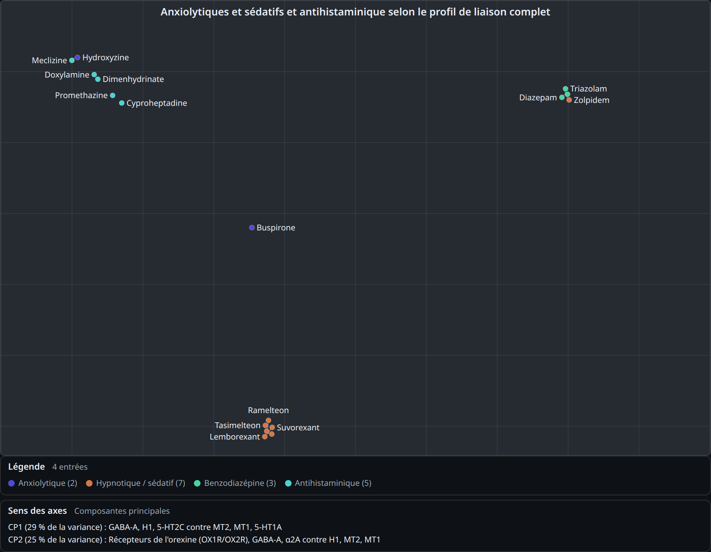
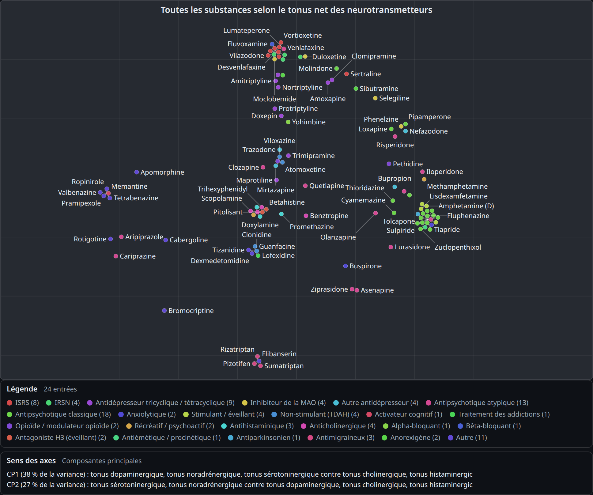

# DrugsMap

[English version](README.md)

Une carte interactive des médicaments psychiatriques et actifs sur le système nerveux central, placés selon la ressemblance de leurs profils de liaison aux [récepteurs](https://fr.wikipedia.org/wiki/R%C3%A9cepteur_(biochimie)). Les substances qui touchent les mêmes récepteurs dans les mêmes proportions se retrouvent proches ; celles aux mécanismes sans rapport se retrouvent éloignées. C'est une page compagnon de [neurarium](https://neurarium.olicorne.org/), un atlas 3D interactif du cerveau pour les neurosciences psychiatriques, entièrement construite à partir du jeu de données sourcé que neurarium sert librement.

Elle permet par exemple d'afficher les antipsychotiques de manière à représenter leur affinité dopaminergique, cholinergique et histaminergique (cliquer sur l'image pour ouvrir cette vue) :

[](https://drugsmap.olicorne.org/#dmcat=antipsychotic_atypical,antipsychotic_conventional&dmmkt=0&dmtgt=aadc,comt,d1,d2,d3,d4,d5,dat,mao_b,vmat2,ache,bche,m1,m2,m3,m4,m5,nachr_a4b2,nachr_a7,h1,h2,h3,h4)

**En ligne :** [drugsmap.olicorne.org](https://drugsmap.olicorne.org/) (aussi sur [neurarium.olicorne.org/drugs-map](https://neurarium.olicorne.org/drugs-map))

Elle a été réalisée avec l'aide de [Claude Code](https://claude.com/claude-code).

**Sommaire :** [Préréglages](#préréglages) · [Ce que montre la carte](#ce-que-montre-la-carte) · [D'où viennent les données](#doù-viennent-les-données) · [Hébergement](#hébergement)

## Préréglages

La boîte **Préréglages** en haut de la page charge une vue toute faite en un clic. Cliquer sur un titre déplie son image, puis sur l'image pour ouvrir cette vue en ligne :

<!-- presets:start -->
<details>
<summary>Antipsychotiques : dopamine</summary>

[](https://drugsmap.olicorne.org/#dmcat=antipsychotic_atypical,antipsychotic_conventional&dmcolor=nbn&dmtgt=d1,d2,d3,d4,d5,dat)

</details>

<details>
<summary>Antipsychotiques : D2 contre 5-HT2A</summary>

[](https://drugsmap.olicorne.org/#dmcat=antipsychotic_atypical,antipsychotic_conventional&dmtgt=d2,5ht2a)

</details>

<details>
<summary>Antipsychotiques : récepteurs des effets indésirables</summary>

[](https://drugsmap.olicorne.org/#dmcat=antipsychotic_atypical,antipsychotic_conventional&dmtgt=h1,m1,alpha1a,5ht2c)

</details>

<details>
<summary>Antidépresseurs : SERT contre NET</summary>

[](https://drugsmap.olicorne.org/#dmcat=ssri,snri,tricyclic,maoi,antidepressant_other&dmtgt=sert,net)

</details>

<details>
<summary>Antidépresseurs par mécanisme</summary>

[](https://drugsmap.olicorne.org/#dmcat=ssri,snri,tricyclic,maoi,antidepressant_other&dmcolor=nbn)

</details>

<details>
<summary>Sommeil et anxiété</summary>

[](https://drugsmap.olicorne.org/#dmcat=benzodiazepine,hypnotic,anxiolytic,antihistamine)

</details>

<details>
<summary>Toutes les substances par tonus</summary>

[](https://drugsmap.olicorne.org/#dmsrc=tone)

</details>
<!-- presets:end -->

## Ce que montre la carte

Chaque substance devient un vecteur, puis une [analyse en composantes principales](https://fr.wikipedia.org/wiki/Analyse_en_composantes_principales) (ACP) projette tous ces vecteurs sur les deux axes qui écartent le plus les substances. L'ACP est recalculée pour ce que les filtres laissent à l'écran : filtrer sur les antipsychotiques donne les axes qui séparent le mieux *les antipsychotiques*, pas toute la liste.

Un exemple concret du vecteur d'une substance, en mode « Récepteurs » : un nombre par cible, l'[affinité](https://fr.wikipedia.org/wiki/Constante_de_dissociation) `pKi - 5` avec `pKi = 9 - log10(Ki en nM)`.

```python
# Ki 1 nM -> pKi 9 -> 4.0 ; Ki 100 nM -> pKi 7 -> 2.0 ; Ki >= 10 µM -> 0 (trop faible pour compter)
# olanzapine (Ki médian: D2 21 nM, 5-HT2A 3.3 nM, H1 2.4 nM, M1 4.7 nM, SERT 2.3 µM)
olanzapine = {"D2": 2.7, "5-HT2A": 3.5, "H1": 3.6, "M1": 3.3, "SERT": 0.6, ...}
```

Par défaut seules les affinités mesurées comptent : une substance sans aucun Ki mesuré n'est pas sur la carte, et une liaison qu'une source affirme sans Ki mesuré est écartée (décocher **Ki mesurés uniquement** pour la compter à 100 nM supposés). Par défaut chaque vecteur est ramené à une longueur unité, pour que la carte compare la *forme* d'un profil (quelles cibles, dans quelles proportions) plutôt que la puissance brute.

Réglages (des boîtes au-dessus du graphique) :

- **Préréglages :** des vues toutes faites, un clic chacune (voir [Préréglages](#préréglages)).

- **Placer selon :** les affinités aux récepteurs, le tonus net par [neurotransmetteur](https://fr.wikipedia.org/wiki/Neurotransmetteur) (l'effet signé de la substance sur chaque système), ou les deux.
- **Signé :** un [agoniste](https://fr.wikipedia.org/wiki/Agoniste) et un [antagoniste](https://fr.wikipedia.org/wiki/Antagoniste) du même récepteur partent dans des directions opposées.
- **Cibles :** restreindre les vecteurs à certaines cibles ; en choisir une ou deux en fait directement les axes (sans ACP).
- **Filtrer les points par :** classe, année de première autorisation, commercialisées uniquement.
- **Couleur selon :** classe, nomenclature [NbN](https://nbn2r.com/), année d'autorisation, laboratoire d'origine, [métabolisme](https://fr.wikipedia.org/wiki/Métabolisme_des_médicaments), ou couverture des Ki.
- **Graphique :** molette / pincement pour zoomer, glisser pour déplacer, rotation à deux doigts pour tourner, bouton plein écran.

Cliquer sur une substance l'ouvre dans l'atlas 3D de neurarium (sa fiche complète : liaisons avec leurs sources citées, métabolisme, histoire...). Un clic droit ou un appui long la masque de la carte. Toute la vue est dans la barre d'adresse : une URL est un lien partageable vers exactement ce qui est à l'écran.

## D'où viennent les données

Tout vient des fichiers de données publics de neurarium (`/data/*.jsonl`, décrits dans [`llms.txt`](https://neurarium.olicorne.org/llms.txt), avec une page Markdown par nœud sous [`/api/`](https://neurarium.olicorne.org/api/)). Les liaisons viennent du Prescriber's Guide de Stahl, de la [base de Ki PDSP](https://pdspdb.unc.edu/databases/kidb.php), du [Guide to Pharmacology IUPHAR/BPS](https://www.guidetopharmacology.org/) et de Wikipédia ; chaque liaison porte sa source citée et un niveau de provenance, consultables en cliquant sur la substance. Cette page est un exemple de ce que l'on peut construire sur ce jeu de données ouvert.

**Limites :** c'est une visualisation exploratoire, pas un avis médical. Les Ki sont mesurés [in vitro](https://fr.wikipedia.org/wiki/In_vitro), souvent sur des récepteurs de rongeur, et ne disent rien de la dose réellement atteinte dans un cerveau ; une ACP ne garde que les deux directions les plus étalées, donc deux substances proches sur la carte peuvent différer sur une cible que les axes ne captent pas (la légende des axes indique quelles cibles pèsent le plus sur chacun).

## Hébergement

<details>
<summary>Comment la page est hébergée, et comment ses images sont faites (cliquer pour déplier)</summary>

Cette page n'est pas un projet séparé : c'est `public/drugs-map.html` dans le dépôt de neurarium, démarrée par `public/js/drugs-map-main.js`, qui réutilise les modules du visualiseur (chargement des données, état de l'URL, thème et langue) sans charger le code 3D. Le conteneur neurarium la sert sur `/drugs-map`.

`drugsmap.olicorne.org` est le même conteneur derrière le reverse proxy extérieur, qui réécrit la racine vers la page : la barre d'adresse garde `drugsmap.olicorne.org` alors que tout est servi par neurarium. Avec Caddy comme proxy extérieur :

```caddy
drugsmap.olicorne.org {
	# Réécriture interne : l'adresse reste drugsmap.olicorne.org/ (le #hash de la vue est gardé)
	rewrite / /drugs-map.html
	# Garder l'application 3D hors de cet hôte : sa page d'entrée renvoie au vrai domaine
	redir /index.html https://neurarium.olicorne.org/ 301
	reverse_proxy <le même upstream que le bloc neurarium.olicorne.org>
}
```

L'image en haut et les images des préréglages (avec la section Préréglages qui les liste) sont rendues par `uv run tools/shot_drugs_map.py` (la vue du haut est le `DEFAULT_HASH` du script, les préréglages sont lus sur les boutons de la page) : la relancer dès que l'apparence de la carte ou ses préréglages changent.

Les liens de la carte vers l'atlas 3D détectent ce cas (page servie sur `/`) et pointent vers `https://neurarium.olicorne.org/` au lieu d'un chemin relatif. Les visites sont comptées par le même site umami que neurarium, sous le nom d'hôte `drugsmap.olicorne.org`.

</details>
